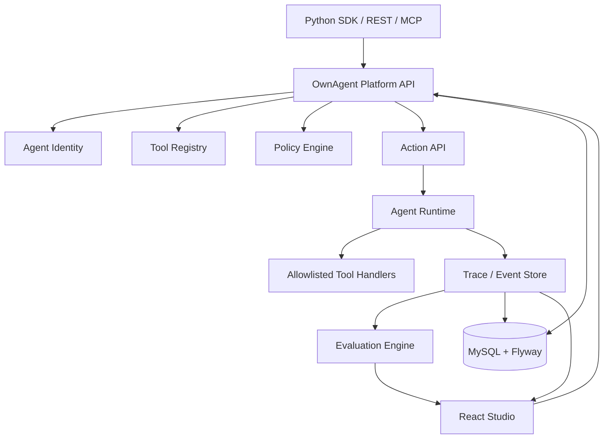

# OwnAgent — Agent Engineering Platform

> Current direction: **Open-source AI Agent Engineering Platform**
>
> Build, run, observe, and evaluate AI Agents.

OwnAgent is evolving from a broad Agent builder prototype into an engineering platform focused on the runtime and lifecycle problems that appear when Agents move beyond demos.

## Product scope

1. **Runtime** — stateful execution, tool orchestration, policy gates, approval, failure handling and recovery.
2. **Observability** — action history, structured events, traces, inputs/outputs, errors and latency.
3. **Evaluation** — repeatable datasets, evaluators, experiment runs, regression comparisons and scorecards.
4. **Studio** — a web interface to connect Agents, configure tools, run Actions, inspect traces and compare evaluations.

OwnAgent is not intended to replace LangGraph or every Agent framework. It will provide its own focused runtime and accept externally built Agents through REST and a Python SDK.

## Repository responsibilities

| Repository | Responsibility | Stack |
| --- | --- | --- |
| `ownsudo` | Platform API, Agent identity, Tool Registry, Policy Engine, Action Runtime and persistence | Java 21, Spring Boot 3, JPA, Flyway, MySQL |
| `builder` | Agent Studio, Action Runs, Trace explorer and Evaluation workbench | React 19, TypeScript, Vite |
| Future `ownagent-python` | Typed SDK and adapters for external Agent implementations | Python |

## Current implementation status

### Backend

Implemented on the current backend feature branch:

- Agent API-key authentication for `/api/v1/**` and Agent-scoped Action ownership.
- Idempotent Action creation.
- Developer-authenticated Tool Registry metadata and input-schema validation.
- Policy decisions: unknown/disabled tools are denied; READ_ONLY/LOW are allowed; MEDIUM/HIGH/CRITICAL require approval.
- Action lifecycle: `READY -> RUNNING -> SUCCEEDED | FAILED`.
- Persisted output, error details, attempt count, timestamps and optimistic version.
- Server-side allowlisted handler registry with two safe examples: `demo.echo` and `text.transform`.
- Action event persistence and Agent-scoped Trace API.
- Explicit execution endpoint; metadata alone never makes arbitrary code executable.

### Frontend

Implemented on the current frontend feature branch:

- Agent API Key and Tool Admin Key connection form.
- Tool Registry metadata management.
- Action creation and policy decision display.
- Explicit execution for `ALLOW / READY` Actions.
- Action output/error display and persisted event trace inspection.

### Not implemented yet

- Full approval decision-to-execution lifecycle.
- Distributed worker scheduling, leases, cancellation and stale-run recovery.
- Enforced timeouts and safe retry semantics for side-effecting tools.
- Nested LLM / Tool spans and end-to-end trace correlation.
- Evaluation datasets, evaluators, experiment runs and regression gates.
- Python SDK and external framework adapters.
- Full RBAC / policy language and multi-Agent key management.

## Runtime safety boundary

The current runtime executes only server-installed handlers. The Tool Registry stores metadata and input contracts; it does not accept arbitrary code, shell commands, SQL, URLs or executable endpoints.

The included `demo.echo` and `text.transform` handlers are deterministic examples intended to demonstrate the Action lifecycle. They are not a general-purpose production tool sandbox.

## Target architecture

## Development roadmap

| Phase | Focus | Deliverable |
| --- | --- | --- |
| P0 | Runtime foundation | Durable Action state machine, handler registry, policy-gated execution, event trace |
| P1 | Runtime reliability | Worker leases, timeout enforcement, cancellation, stale-run recovery, retry/idempotency semantics |
| P2 | Observability | Span model, parent-child trace, LLM/tool metadata, redaction, latency and token metrics |
| P3 | Evaluation | Dataset versioning, deterministic evaluators, experiment runs, baseline comparison, regression gate |
| P4 | Python SDK | Typed client, idempotency helpers, wait/poll, external Agent adapters |
| P5 | Studio | Agent registry, run explorer, trace waterfall, evaluation workbench, reproducible demos |

## Interview demonstration

A useful end-to-end demonstration should show:

1. Register a tool with a JSON input contract and risk level.
2. Submit an Action from an Agent client.
3. Show the Policy Engine decision.
4. Execute an allowed Action through a server-installed handler.
5. Inspect persisted Action events and output.
6. Demonstrate denied and approval-required Actions are not executed.
7. Run a repeatable evaluation suite and compare results once the Evaluation Engine is implemented.

Do not claim a capability is complete until it has tests and a reproducible demonstration.
